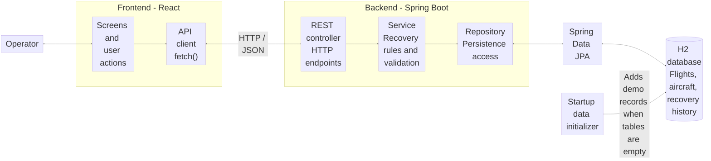

# Flight Operations Recovery Console

A beginner-friendly demo of how a flight operations team could respond when a flight's assigned aircraft becomes unavailable. The app finds compatible replacement aircraft, lets an operator choose one, records the recovery, and shows completed incidents in a history screen.

> **Demo only:** This independent portfolio project uses fictional sample data. It is not affiliated with an airline or operator, and must not be used to make real flight, dispatch, or safety decisions.

## What happens in the demo?

The app starts with one sample flight:

| Item | Sample value |
| --- | --- |
| Flight | NJ 1001 |
| Route | KTEB to KMIA |
| Assigned aircraft | N700NJ |
| Problem | Maintenance hold |
| Flight status | DISRUPTED |

When you open **Recovery**, the backend checks the aircraft pool and returns available aircraft of the type required by the flight. Aircraft already at the departure airport are listed first:

- **N701NJ** is at KTEB, so it does not need to be repositioned.
- **N702NJ** is at KOPF, so it would need to be repositioned to KTEB.

Choose an aircraft and select **Assign selected aircraft**. The backend marks the flight **RECOVERED**, marks the replacement aircraft assigned, and saves a history record. Open **History** to see the incident reason, original and replacement aircraft, aircraft location, repositioning requirement, and recovery time.

## A few terms

- **Disrupted flight:** A flight that cannot use its currently assigned aircraft.
- **Recovery option:** An available aircraft that matches the flight's aircraft type.
- **Repositioning:** Moving an aircraft from where it is now to the flight's departure airport.
- **API:** A way for the frontend and backend to exchange requests and data.
- **H2:** A small database used by this project to save its sample flights, aircraft, and recovery history on your computer.

## How the application is organized

The project has a browser frontend and a Java backend. The frontend sends HTTP requests to the backend; it does not make recovery decisions itself.

### Frontend: `frontend/`

- `src/App.jsx` manages the selected tab, flight data, and user actions.
- `src/api.js` sends requests to the backend API.
- `src/components/` contains the smaller screen sections, such as the flight list, recovery options, dispatch board, and history.
- `src/styles.css` controls the appearance and responsive layout.

### Backend: `backend/`

Requests follow this path:

1. **Controller** (`api/FlightController.java`) receives the HTTP request.
2. **Service** (`service/FlightRecoveryService.java`) applies the recovery rules.
3. **Repository** (`repository/FlightRepository.java`) reads and writes data.
4. **JPA repositories and entities** (`repository/*JpaRepository.java`, `entity/`) connect Java data to database tables.
5. **H2 database** stores the records locally.

The `model/` folder holds the Java data objects used by the application. `config/DataInitializer.java` adds the sample flight and aircraft when the database has no corresponding records.

### System diagram

This interview-level view shows the main components, their responsibilities, and how a recovery request moves through the system:



For an aircraft reassignment, the API client sends a `POST` request. The controller passes it to the service, which checks that the flight is disrupted and the replacement aircraft is available and compatible. The repository saves the recovered flight, updates the aircraft, and records the incident in H2. The backend returns a JSON response through the same path, and the frontend refreshes the screen.

## Requirements

Install the following tools:

- **Java 17 or newer** — runs the backend.
- **Maven** — builds and starts the backend.
- **Node.js with npm** — installs and runs the frontend.

Open PowerShell and check that the commands are available:

```powershell
java -version
mvn -version
node --version
npm.cmd --version
```

If a command is not recognized, install that tool and open a new PowerShell window. Use Java 17 or newer.

## Run the application on Windows

Keep **two PowerShell windows open**: one for the backend and one for the frontend. In both examples, replace the path below with the location where you saved the project.

### 1. Start the backend

In the first PowerShell window, change to the backend folder and start Spring Boot:

```powershell
cd "C:\path\to\FlightOps Recovery Console\backend"
mvn spring-boot:run
```

Wait for the startup message indicating that Spring Boot has started. Keep this window open. The backend uses port **8080** and creates or opens the local H2 database.

### 2. Start the frontend

In the second PowerShell window, change to the frontend folder:

```powershell
cd "C:\path\to\FlightOps Recovery Console\frontend"
npm.cmd install
npm.cmd run dev
```

`npm.cmd install` downloads the frontend packages. Run it the first time, or when frontend dependencies change. Keep this window open too.

Open the address printed by Vite. It is usually:

```text
http://127.0.0.1:5173
```

Both the backend and frontend must be running while you use the app. Stop either process with **Ctrl+C** in its PowerShell window.

## Use the application

- **Overview** shows the operations summary, flight queue, selected flight, and recovery options.
- **Flights** shows the flight manifest.
- **Recovery** lets you review a disrupted flight and assign a replacement aircraft.
- **Dispatch** shows flight updates and provides shortcuts to the related flight or recovery.
- **History** shows completed recoveries saved in the database.

To try the recovery:

1. Find NJ 1001, which starts as **DISRUPTED**.
2. Open **Recovery** and compare the aircraft choices and their locations.
3. Select **N701NJ** or **N702NJ**.
4. Select **Assign selected aircraft**.
5. Confirm that the flight is now **RECOVERED**.
6. Open **History** to see how the incident was resolved.

## Data and database

The database is stored locally at:

```text
backend/data/flightops.mv.db
```

Unlike an in-memory database, this file keeps flight changes and recovery history when you stop and restart the backend. The sample flight and aircraft are seeded when their database tables are empty. After recovering the sample flight, it stays recovered on later starts.

To start the sample workflow over, stop the backend first with **Ctrl+C**. In a PowerShell window, change to the backend folder and remove the database file:

```powershell
cd "C:\path\to\FlightOps Recovery Console\backend"
Remove-Item .\data\flightops.mv.db
```

Then start the backend again with `mvn spring-boot:run`. H2 creates a fresh database and the sample data is seeded again. Only remove this file if you are comfortable losing the local demo changes and recovery history.

### Optional: open the H2 database console

With the backend running, open:

```text
http://localhost:8080/h2-console
```

Enter these connection values and select **Connect**:

| Field | Value |
| --- | --- |
| Driver Class | `org.h2.Driver` |
| JDBC URL | `jdbc:h2:file:./data/flightops;MODE=PostgreSQL;DB_CLOSE_ON_EXIT=FALSE` |
| User Name | `sa` |
| Password | Leave blank |

The console is a developer tool for viewing the local database. The JDBC URL must match the backend configuration.

## API endpoints

You can open these URLs in a browser while the backend is running:

| Method | URL | Purpose |
| --- | --- | --- |
| `GET` | `http://localhost:8080/api/flights` | List flights |
| `GET` | `http://localhost:8080/api/flights/FL-1001/recovery-options` | List compatible recovery aircraft for a disrupted flight |
| `POST` | `http://localhost:8080/api/flights/FL-1001/reassign` | Assign a chosen aircraft to a disrupted flight |
| `GET` | `http://localhost:8080/api/flights/history` | List completed recovery records, newest first |

The `POST` request expects JSON such as:

```json
{
  "aircraftId": "N701NJ"
}
```

## Run the tests

From the backend folder, run:

```powershell
mvn test
```

This runs the backend's automated tests. To create a production frontend build, open another PowerShell window, change to the frontend folder, and run:

```powershell
npm.cmd run build
```

## Troubleshooting

- **The browser says it cannot reach the API:** Check that the backend is still running in the first PowerShell window.
- **`mvn` is not recognized:** Install Maven, make sure it is on your PATH, and open a new PowerShell window.
- **`java` is not recognized or is too old:** Install Java 17 or newer and reopen PowerShell.
- **`npm` script execution is blocked in PowerShell:** Use `npm.cmd` as shown above instead of `npm`.
- **Port 8080 or 5173 is already in use:** Stop the other app using that port, then start this app again.
- **H2 console shows an error:** Confirm the backend started successfully, use `http://localhost:8080/h2-console`, and check that the JDBC URL is copied exactly.
- **The sample flight is already recovered:** That change is saved. Stop the backend, remove `backend/data/flightops.mv.db` as described above, and restart it to restore the initial demo data.

## Limits of this demo

Recovery decisions only consider aircraft type, availability, and current airport. The app does not evaluate crew, real maintenance records, weather, airport restrictions, aircraft performance, passenger needs, or other dispatch requirements. Its sample data and simplified rules are for learning and demonstration only.
